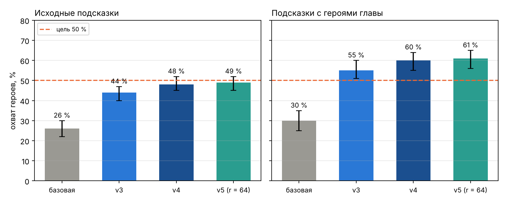

# Results / Результаты

Fine-tuning ruGPT3 + LoRA on 3303 chapter examples (train 2810 / val 226 / test 267). Google Colab, T4 GPU.
Дообучение ruGPT3 + LoRA на 3303 примерах-главах (train 2810 / val 226 / test 267). Google Colab, T4.

## Runs / Запуски

| Run | Model | Window | Epochs | Best val loss / perplexity |
|---|---|---|---|---|
| v1 | ruGPT3 small | 1024 | 3 | 3.148 / 23.3 |
| v2 | ruGPT3 small | 1024 | 8 (best step ~700) | 3.125 / 22.8 |
| v3 | ruGPT3 medium | 2048 | 6 (best step 528) | 2.825 / 16.9 |

Perplexity before and after fine-tuning (val / test): small 26.1 → 22.8 / 23.1 → 19.3; medium 18.9 → 16.9 / 16.6 → 14.5.
Perplexity of runs with different window length is only roughly comparable.

## Prompt following (50 test prompts, chapter up to 350 tokens) / Следование подсказке

| Model | Hero coverage | All heroes named | Junk | 3-gram repeats | Words per chapter |
|---|---|---|---|---|---|
| reference (real chapters) | 51% | 18% | 0% | 0.7% | 211 |
| small: base | 14% | 4% | 30% | 7.6% | 214 |
| small: v1 | 30% | 2% | 0% | 0.4% | 250 |
| small: v2 | 28% | 2% | 0% | 0.9% | 252 |
| medium: base | 29% | 4% | 38% | 4.4% | 209 |
| medium: v3 | 27% | 2% | 0% | 0.3% | 247 |

Note (stage 5): the stage-4 conclusion that fine-tuning does not improve hero coverage for medium was a measurement error, see the next section. These numbers use `repetition_penalty = 1.1`, which lowers hero coverage.
Примечание (этап 5): вывод этапа 4 о том, что у medium дообучение не улучшает охват героев, был ошибкой измерения, см. следующий раздел. Эти цифры получены со штрафом `repetition_penalty = 1.1`, который занижает охват героев.

## Stage 5: why the model followed the prompt poorly / Этап 5: почему модель слабо следовала подсказке

Goals: hero coverage >= 50% (real chapters: 51%) and perplexity below the base model. Notebooks: `notebooks/02_experiments.ipynb` (all experiments), `notebooks/03_experiment_rank64.ipynb` (rank 64), `notebooks/01_final_model.ipynb` (final model).
Цели: охват героев не ниже 50% (у настоящих глав 51%) и перплексия ниже, чем у базовой модели.

**Experiment 1: repetition penalty (50 prompts, model v3) / штраф за повторы.** The penalty also lowers the probability of tokens from the prompt, i.e. hero names.

| Decoding | Hero coverage |
|---|---|
| penalty 1.0 | 45% |
| penalty 1.05 | 37% |
| penalty 1.1 (stage 4) | 27% |
| penalty 1.2 | 25% |
| penalty 1.0 + no_repeat_ngram_size = 4 (chosen) | 44% |

With the chosen decoding the base medium gives 22% (junk in 34% of chapters) and v3 gives 44% (junk 0%).

**Experiment 2: prompts with the heroes of the chapter (v4) / подсказки с героями главы.** In the training data only 66% of the heroes in the prompt occur in the chapter text. For v4 the "Герои:" line keeps only the heroes named in the chapter (train 2810 -> 2677). Evaluation on 250 test prompts, 95% bootstrap confidence intervals:

| Prompts | base | v3 | v4 |
|---|---|---|---|
| original | 26% (22-30) | 44% (40-47) | 48% (45-52) |
| heroes of the chapter | 30% (25-35) | 55% (51-60) | 60% (55-64) |

v4 - v3: +4.7 pp (95% CI +1.0..+8.4) and +4.5 pp (+0.1..+8.9). Perplexity (val / test, corrected prompts): base 18.7 / 16.2, v3 16.7 / 14.1, v4 16.7 / 14.1.

**Experiment 3: LoRA rank 64 (v5) / ранг LoRA 64.** 25.2M trainable parameters instead of 6.29M. Hero coverage 49% / 61% vs 50% / 60% for v4 (difference within noise: -0.9 pp, CI -4.2..+2.5, and +0.9 pp, CI -3.3..+5.0); perplexity test 14.0 vs 14.1. The adapter capacity is not the bottleneck.

**Result / Итог.** The final model is medium + LoRA v4 (rank 16), decoding with `repetition_penalty = 1.0` and `no_repeat_ngram_size = 4`. Goal 1: almost reached on original prompts (48%, CI 45-52%), reached in the product scenario with the heroes of the chapter (60%, CI 55-64%). Goal 2 reached (test perplexity 14.1 vs 16.2). Remaining gap to real chapters: 60% vs 74% (heroes of the chapter), all heroes named 35% vs 56%; likely causes are the small corpus (about 2700 examples) and heroes that are named only in neighbouring chapters. Not yet done: human evaluation, child name substitution. Generation on GPU varies by about 1-2 pp between runs.
Итог: финальная модель — medium + LoRA v4 (ранг 16) с генерацией без штрафа и с запретом повторов 4-грамм. Цель по охвату героев почти достигнута на исходных подсказках (48%) и достигнута в сценарии продукта (60%); перплексия лучше базовой.

## Figures / Графики

- `v3/training_curves.png` — loss and perplexity, run v3
- `v3/extra_charts.png` — example length, learning rate, perplexity before/after, val loss of all runs
- `prompt_following.png` — prompt-following metrics (stage 4, 50 prompts)
- `stage5/hero_coverage_250.png` — hero coverage on 250 prompts, base / v3 / v4 / v5 (stage 5)

Adapters, full corpus texts and API keys are not stored in the repository.
